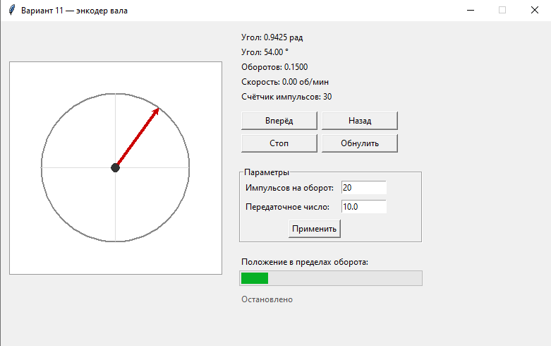
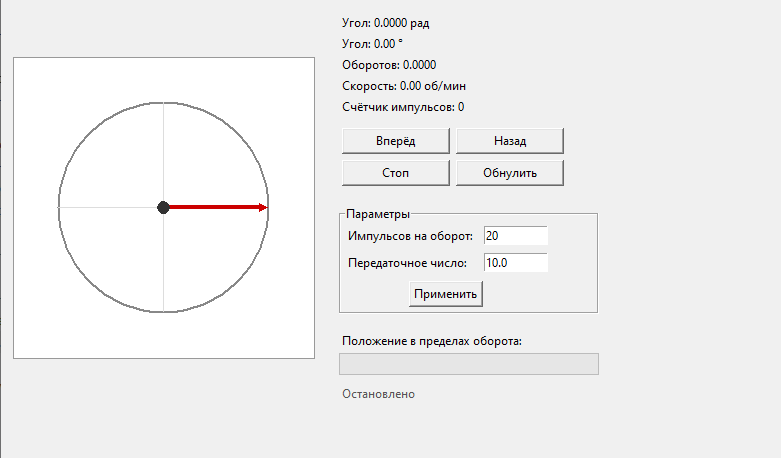
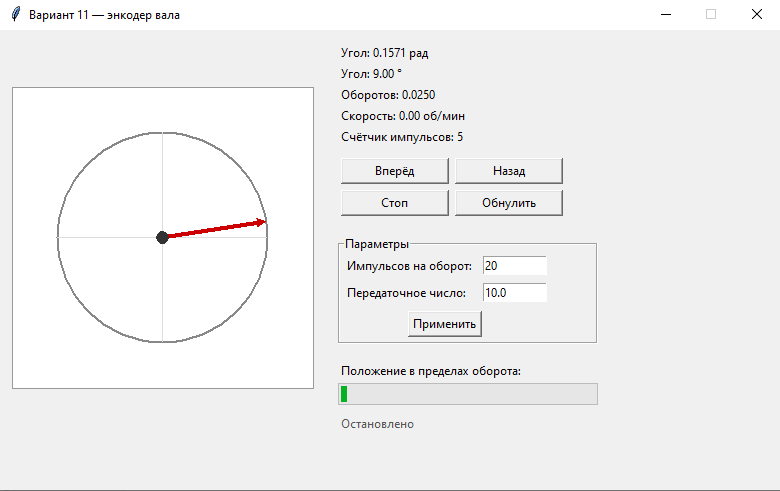
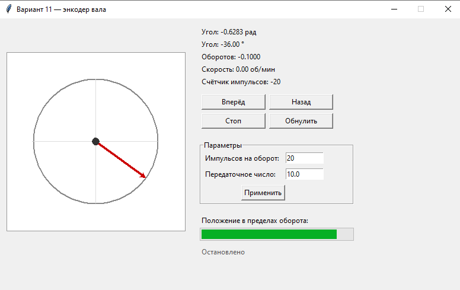
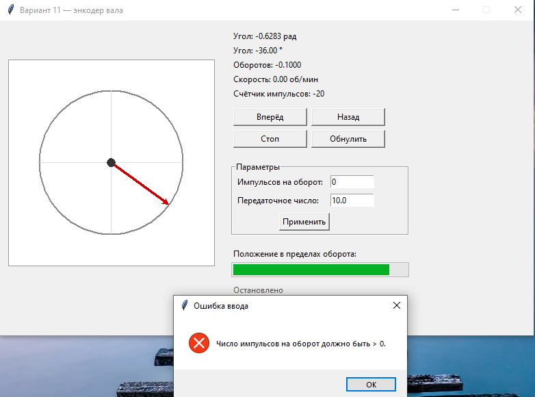
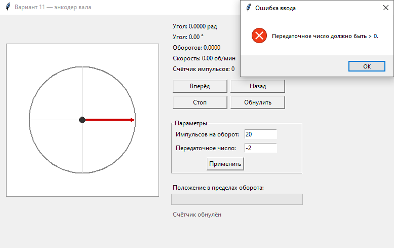

Министерство науки и высшего образования Российской Федерации

Федеральное государственное автономное образовательное учреждение
высшего образования

«Омский государственный технический университет»

Кафедра «Автоматизация и робототехника»

Лабораторная работа №5\
Объектно-ориентированное программирование (ООП) в приложении с оконным
интерфейсом\
по дисциплине: "Программирование на языке Python"

Выполнил\
студент группы УТС-251т;\
Нестор Валерий Владимирович

Проверил:\
Доцент, канд. техн. наук\
Ситников Дмитрий Владимирович

Омск 2026

**Цель работы**

Изучить основы объектно-ориентированного программирования в Python
(классы, инкапсуляция, наследование, полиморфизм) и получить
практические навыки разработки настольного приложения с графическим
интерфейсом на библиотеке Tkinter для моделирования и контроля
мехатронного объекта --- энкодера вала.

**Индивидуальное задание (Вариант 11)**

Тема: Энкодер вала.\
Классы модели:

Encoder --- хранит число импульсов на оборот (pulses_per_rev) и счётчик
импульсов (counter).

GearedEncoder --- потомок Encoder, учитывает передаточное число
редуктора (gear_ratio) при расчёте угла, оборотов и скорости выходного
вала.

Требования к окну:

кнопки «Вращать вперёд» / «Вращать назад» (шаг по таймеру через
after());

кнопка «Стоп»;

кнопка «Обнулить счётчик»;

Canvas с вращающейся стрелкой;

вывод угла в радианах и градусах, числа оборотов и скорости (об/мин);

Progressbar, показывающий положение в пределах одного оборота;

поля Entry для настройки числа импульсов на оборот и передаточного
числа;

обработка некорректного ввода через try/except и messagebox.showerror.

**Диаграмма классов**\
В программе использованы три класса**:**

**1.** Encoder **---** базовый класс энкодера

Атрибуты:

\_ppr --- число импульсов на оборот (защищённый);

\_counter --- счётчик импульсов (защищённый, только чтение через
свойство counter).

Свойства:

pulses_per_rev --- чтение/запись с проверкой (\> 0);

counter --- только чтение;

angle_rad, angle_deg, revolutions --- вычисляемые (только чтение).

Методы:

\_\_init\_\_(pulses_per_rev, counter);

step(direction, pulses) --- изменить счётчик;

reset() --- обнулить счётчик;

speed_rpm(dt, direction, pulses) --- скорость вала в об/мин;

\_\_str\_\_() --- строковое представление.

**2.** GearedEncoder **---** потомок Encoder (учёт редуктора)

Наследование: class GearedEncoder(Encoder) с вызовом
super().\_\_init\_\_(\...).

Дополнительный атрибут:

\_gear --- передаточное число (защищённый).

Свойство:

gear_ratio --- чтение/запись с проверкой (\> 0).

Переопределённые методы (полиморфизм):

angle_rad --- угол выходного вала (делится на gear_ratio);

revolutions --- обороты выходного вала;

speed_rpm(\...) --- скорость выходного вала;

\_\_str\_\_().

Класс интерфейса

**3.** EncoderApp **---** наследник tk.Tk

Связь с моделью: агрегация --- хранит ссылку self.encoder на объект
GearedEncoder, но не содержит расчётов угла, оборотов и скорости (все
вычисления делегируются модели).

Атрибуты состояния:

encoder --- объект модели;

direction --- текущее направление вращения (+1, -1, 0);

\_after_id --- идентификатор таймера after();

StringVar-переменные для вывода значений.

Методы:

\_\_init\_\_() --- создание окна и модели;

\_build_widgets() --- построение виджетов;

\_start(), \_stop(), \_reset(), \_apply() --- обработчики кнопок;

\_schedule_tick(), \_tick() --- таймер моделирования;

\_update_view(), \_draw_arrow() --- обновление показаний и перерисовка
Canvas;

destroy() --- отмена таймера при закрытии.

Связи между классами:

GearedEncoder **→** Encoder --- наследование (super().\_\_init\_\_()).

EncoderApp **→** GearedEncoder --- агрегация (окно использует модель, но
не является ею).

Модель (Encoder, GearedEncoder) не импортирует tkinter --- логика
отделена от интерфейса.

**5. Макет окна приложения и перечень виджетов**

  -------------------------------------------------------------------------
  Виджет            Назначение в программе
  ----------------- -------------------------------------------------------
  tk.Tk             корневое окно EncoderApp

  tk.Frame          контейнеры для левой и правой частей

  tk.Canvas         вращающаяся стрелка выходного вала

  ttk.Progressbar   положение в пределах одного оборота

  tk.Button         «Вперёд», «Назад», «Стоп», «Обнулить», «Применить»

  tk.Label          вывод угла, оборотов, скорости, счётчика, статуса

  tk.Entry          ввод числа импульсов на оборот и передаточного числа

  tk.LabelFrame     группа «Параметры»

  tk.StringVar      связывание переменных с метками

  tk.messagebox     диалог ошибки ввода
  -------------------------------------------------------------------------

**Листинг программы**

import math

import tkinter as tk

from tkinter import ttk, messagebox

class Encoder:

    \"\"\"Энкодер вала: число импульсов на оборот и счётчик
импульсов.\"\"\"

    def \_\_init\_\_(self, pulses_per_rev: int = 20, counter: int = 0):

        self.\_ppr = 20

        self.pulses_per_rev = pulses_per_rev

        self.\_counter = int(counter)

    \@property

    def pulses_per_rev(self) -\> int:

        \"\"\"Число импульсов на оборот (свойство с проверкой).\"\"\"

        return self.\_ppr

    \@pulses_per_rev.setter

    def pulses_per_rev(self, value) -\> None:

        value = int(value)

        if value \<= 0:

            raise ValueError(\"Число импульсов на оборот должно быть \>
0.\")

        self.\_ppr = value

    \@property

    def counter(self) -\> int:

        \"\"\"Текущее значение счётчика (только чтение).\"\"\"

        return self.\_counter

    def step(self, direction: int = 1, pulses: int = 1) -\> None:

        \"\"\"Изменить счётчик: direction = +1 / -1, pulses \> 0.\"\"\"

        if direction not in (-1, 1):

            raise ValueError(\"Направление должно быть +1 или -1.\")

        pulses = int(pulses)

        if pulses \<= 0:

            raise ValueError(\"Число импульсов должно быть \> 0.\")

        self.\_counter += direction \* pulses

    def reset(self) -\> None:

        \"\"\"Обнулить счётчик.\"\"\"

        self.\_counter = 0

    \@property

    def angle_rad(self) -\> float:

        return 2.0 \* math.pi \* self.\_counter / self.\_ppr

    \@property

    def angle_deg(self) -\> float:

        return math.degrees(self.angle_rad)

    \@property

    def revolutions(self) -\> float:

        return self.\_counter / self.\_ppr

    def speed_rpm(self, dt: float, direction: int = 1, pulses: int = 1)
-\> float:

        if dt \<= 0:

            raise ValueError(\"Интервал должен быть больше нуля.\")

        return direction \* (pulses / dt) / self.\_ppr \* 60.0

    def \_\_str\_\_(self) -\> str:

        return f\"Encoder(PPR={self.\_ppr}, counter={self.\_counter})\"

class GearedEncoder(Encoder):

    \"\"\"Энкодер с редуктором: учитывает передаточное число.\"\"\"

    def \_\_init\_\_(self, pulses_per_rev: int = 20,

                 gear_ratio: float = 1.0, counter: int = 0):

        super().\_\_init\_\_(pulses_per_rev, counter)

        self.gear_ratio = gear_ratio

    \@property

    def gear_ratio(self) -\> float:

        \"\"\"Передаточное число (свойство с проверкой).\"\"\"

        return self.\_gear

    \@gear_ratio.setter

    def gear_ratio(self, value) -\> None:

        value = float(value)

        if value \<= 0:

            raise ValueError(\"Передаточное число должно быть \> 0.\")

        self.\_gear = value

    \# Полиморфизм: переопределяем расчёт для выходного вала

    \@property

    def angle_rad(self) -\> float:

        return super().angle_rad / self.\_gear

    \@property

    def revolutions(self) -\> float:

        return super().revolutions / self.\_gear

    def speed_rpm(self, dt: float, direction: int = 1, pulses: int = 1)
-\> float:

        return super().speed_rpm(dt, direction, pulses) / self.\_gear

    def \_\_str\_\_(self) -\> str:

        return (f\"GearedEncoder(PPR={self.\_ppr}, gear={self.\_gear:g},
\"

                f\"counter={self.\_counter})\")

class EncoderApp(tk.Tk):

    \"\"\"Главное окно приложения для варианта 11.\"\"\"

    TICK = 100   \# период таймера, мс

    STEP = 1     \# импульсов за один шаг таймера

    def \_\_init\_\_(self):

        super().\_\_init\_\_()

        self.title(\"Вариант 11 --- энкодер вала\")

        self.geometry(\"780x460\")

        self.resizable(False, False)

        \# Модель и состояние

        self.encoder = GearedEncoder(pulses_per_rev=20, gear_ratio=10.0)

        self.direction = 0

        self.\_after_id = None

        \# Переменные для вывода

        self.angle_rad_var = tk.StringVar()

        self.angle_deg_var = tk.StringVar()

        self.revolutions_var = tk.StringVar()

        self.rpm_var = tk.StringVar()

        self.counter_var = tk.StringVar()

        self.status_var = tk.StringVar(value=\"Остановлено\")

        self.\_build_widgets()

        self.\_update_view()

        self.\_schedule_tick()

    def \_build_widgets(self) -\> None:

        \# Слева --- Canvas со стрелкой

        left = tk.Frame(self)

        left.grid(row=0, column=0, padx=12, pady=12)

        self.canvas = tk.Canvas(left, width=300, height=300,
bg=\"white\",

                                highlightthickness=1,

                                highlightbackground=\"#999999\")

        self.canvas.pack()

        \# Справа --- показания и управление

        right = tk.Frame(self)

        right.grid(row=0, column=1, padx=12, pady=12, sticky=\"n\")

        for var in (self.angle_rad_var, self.angle_deg_var,

                    self.revolutions_var, self.rpm_var,
self.counter_var):

            tk.Label(right, textvariable=var,
anchor=\"w\").pack(fill=\"x\")

        buttons = tk.Frame(right)

        buttons.pack(fill=\"x\", pady=8)

        tk.Button(buttons, text=\"Вперёд\", width=14,

                  command=lambda: self.\_start(1)).grid(row=0, column=0,
padx=3, pady=3)

        tk.Button(buttons, text=\"Назад\", width=14,

                  command=lambda: self.\_start(-1)).grid(row=0,
column=1, padx=3, pady=3)

        tk.Button(buttons, text=\"Стоп\", width=14,

                  command=self.\_stop).grid(row=1, column=0, padx=3,
pady=3)

        tk.Button(buttons, text=\"Обнулить\", width=14,

                  command=self.\_reset).grid(row=1, column=1, padx=3,
pady=3)

        settings = tk.LabelFrame(right, text=\"Параметры\")

        settings.pack(fill=\"x\", pady=8)

        tk.Label(settings, text=\"Импульсов на оборот:\").grid(

            row=0, column=0, sticky=\"w\", padx=4, pady=3)

        self.ppr_entry = tk.Entry(settings, width=10)

        self.ppr_entry.insert(0, str(self.encoder.pulses_per_rev))

        self.ppr_entry.grid(row=0, column=1, padx=4, pady=3)

        tk.Label(settings, text=\"Передаточное число:\").grid(

            row=1, column=0, sticky=\"w\", padx=4, pady=3)

        self.gear_entry = tk.Entry(settings, width=10)

        self.gear_entry.insert(0, str(self.encoder.gear_ratio))

        self.gear_entry.grid(row=1, column=1, padx=4, pady=3)

        tk.Button(settings, text=\"Применить\",

                  command=self.\_apply).grid(row=2, column=0,
columnspan=2, pady=5)

        tk.Label(right, text=\"Положение в пределах оборота:\").pack(

            anchor=\"w\", pady=(8, 2))

        self.progress = ttk.Progressbar(right, orient=\"horizontal\",

                                        length=260, maximum=100)

        self.progress.pack(fill=\"x\")

        tk.Label(right, textvariable=self.status_var,

                 fg=\"#555555\").pack(anchor=\"w\", pady=(8, 0))

    def \_start(self, d: int) -\> None:

        self.direction = d

        self.status_var.set(\"Вращение вперёд\" if d \> 0 else
\"Вращение назад\")

    def \_stop(self) -\> None:

        self.direction = 0

        self.status_var.set(\"Остановлено\")

    def \_reset(self) -\> None:

        self.encoder.reset()

        self.status_var.set(\"Счётчик обнулён\")

    def \_apply(self) -\> None:

        \# Проверка ввода через try/except без аварийного завершения

        try:

            self.encoder.pulses_per_rev = int(self.ppr_entry.get())

            self.encoder.gear_ratio = float(self.gear_entry.get())

        except (ValueError, TypeError) as exc:

            messagebox.showerror(\"Ошибка ввода\", str(exc))

            return

        self.status_var.set(\"Параметры применены\")

    def \_schedule_tick(self) -\> None:

        self.\_after_id = self.after(self.TICK, self.\_tick)

    def \_tick(self) -\> None:

        try:

            if self.direction:

                self.encoder.step(self.direction, self.STEP)

            self.\_update_view()

        finally:

            self.\_schedule_tick()

    def \_update_view(self) -\> None:

        ang = self.encoder.angle_rad

        rpm = (self.encoder.speed_rpm(self.TICK / 1000.0,

                                      self.direction, self.STEP)

               if self.direction else 0.0)

        self.angle_rad_var.set(f\"Угол: {ang:.4f} рад\")

        self.angle_deg_var.set(f\"Угол: {self.encoder.angle_deg:.2f}
°\")

        self.revolutions_var.set(f\"Оборотов:
{self.encoder.revolutions:.4f}\")

        self.rpm_var.set(f\"Скорость: {rpm:.2f} об/мин\")

        self.counter_var.set(f\"Счётчик импульсов:
{self.encoder.counter}\")

        self.progress\[\"value\"\] = (ang % (2 \* math.pi)) / (2 \*
math.pi) \* 100

        self.\_draw_arrow(ang)

    def \_draw_arrow(self, ang: float) -\> None:

        c = self.canvas

        c.delete(\"all\")

        cx, cy, r = 150, 150, 105

        c.create_oval(cx - r, cy - r, cx + r, cy + r, outline=\"#888\",
width=2)

        c.create_line(cx - r, cy, cx + r, cy, fill=\"#dddddd\")

        c.create_line(cx, cy - r, cx, cy + r, fill=\"#dddddd\")

        x, y = cx + r \* math.cos(ang), cy - r \* math.sin(ang)

        c.create_line(cx, cy, x, y, arrow=tk.LAST, width=4,
fill=\"#cc0000\")

        c.create_oval(cx - 6, cy - 6, cx + 6, cy + 6, fill=\"#333333\",
outline=\"\")

    def destroy(self) -\> None:

        if self.\_after_id is not None:

            self.after_cancel(self.\_after_id)

        super().destroy()

def main() -\> None:

    \"\"\"Запустить приложение.\"\"\"

    EncoderApp().mainloop()

if \_\_name\_\_ == \"\_\_main\_\_\":

    \# Проверка модели без интерфейса

    e = GearedEncoder(20, 10.0)

    e.step(1, 20)

    assert abs(e.angle_deg - 36.0) \< 1e-9

    print(\"Проверка модели:\", e)

    main()

**Результаты работы (снимки окна для штатных и граничных сценариев).**

## **Выводы**

В ходе работы я сделал приложение «Энкодер вала» на Python с Tkinter.
Получилось три класса: базовый Encoder, его потомок GearedEncoder и окно
EncoderApp. На практике применил все четыре принципа ООП: инкапсуляцию
(свойства с проверкой), наследование через super(), полиморфизм
(переопределил методы в потомке) и \_\_str\_\_. Модель не зависит от
tkinter, поэтому её легко проверить отдельно, без окна. Ввод
обрабатывается через try/except --- при ошибке просто показывается
сообщение, программа не падает. В итоге цель работы достигнута: я
разобрался, как применять ООП в реальном приложении с интерфейсом.
